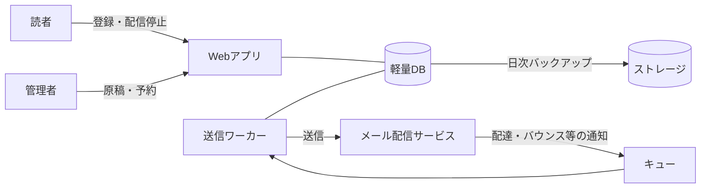
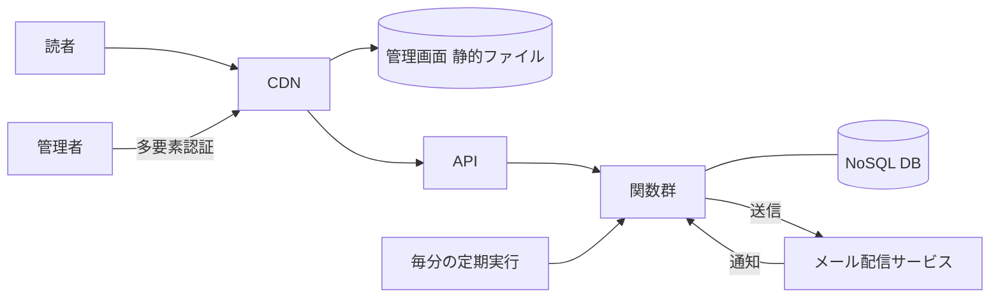

# 小規模団体のメールマガジン配信 — 構築・運用事務代行の経験談

> 秘密保持契約のため、クライアント名・業種の詳細・地域・ドメイン・設定値・ソースコードは掲載していません。
> 内容は実際の業務をもとに一般化した経験談です。

## 概要

| 項目 | 内容 |
|---|---|
| 期間 | 2026年10月〜（継続中） |
| 立場 | 運用事務代行（配信基盤の構築・移行、日々の配信運用、保守） |
| クライアント | 地方の小規模団体 |
| 規模 | 管理者1名、読者100名未満、週1回程度の配信 |
| 主な技術 | AWS（SES、Lambda、DynamoDB、API Gateway、CloudFront、Cognito、SQS/SNS、SAM）、Python、React、TypeScript |
| 開発の進め方 | AI コーディングツール（Claude Code）を活用し、要件・判断・本番操作の承認は自分が担当 |

## 背景と課題

団体の公式サイトから読者を募り、団体のドメインを送信元にしたメールマガジンを届けたい、という依頼でした。

- 読者数が少なく、月額制の配信サービスでは費用が見合わない
- 読者の同意（登録・配信停止の履歴）を自分たちで確実に管理したい
- 団体のドメインから送り、迷惑メール扱いされにくくしたい
- 管理者はエンジニアではないため、画面操作だけで原稿作成・予約・配信状況の確認ができる必要がある
- Web からの登録に加えて、紙の申込書で届く申込みにも対応したい

## AWS を選択した理由（既製サービスとの費用比較）

独自ドメインから送れる国内のメルマガ配信サービスを軽く調べたところ、小規模向けプランでも月額およそ 3,000〜5,500 円が相場でした。

| 選択肢 | 月額の目安（税抜） | 初期費用の目安 | 備考 |
|---|---:|---:|---|
| ブラストメール（Light・5,000件まで） | 約 4,000 円 | 約 5,000〜10,000 円 | 無料プランなし |
| アスメル（通常プラン） | 約 3,600 円 | 約 15,000 円 | 公表価格は税込 3,999 円 |
| オレンジメール（ビジネス5000） | 約 5,000 円 | 約 13,000 円 | 公表価格は税込 5,478 円 |
| **今回：AWS 第1期（単一サーバー）** | **約 2,400 円**（約 16 ドル） | 0 円 | 費用の大半は常時起動のサーバー |
| **今回：AWS 第2期（サーバーレス）** | **約 50 円以下**（1 ドル未満） | 0 円 | 配信は 1,000 通あたり約 0.1 ドル |

- 読者が100名未満・週1回程度の配信では、配信サービスの料金の大半は使わない容量への支払いになる
- AWS は使った分だけの従量課金で、読者が1,000名に増えても配信基盤の費用は月 1 ドル前後の見込み
- 年間で比べると、既製サービスの約 4〜6 万円に対し、サーバーレス構成では数百円程度
- 一方で、自前構築では構築・保守の手間と、法令対応（配信停止・送信者表示など）を自分たちで担う必要がある。この部分を運用事務代行として引き受けた

※ 既製サービスの料金は 2026年11月時点に比較サイト・公式情報で確認した概算です（為替は 1 ドル≒150 円で換算）。最新の料金は各社の公式サイトをご確認ください。参考：[一創「メール配信サービス比較」](https://www.issoh.co.jp/md/column/15830)、[atsoho「ブラストメール」](https://atsoho.com/apps/p/blastmail)、[imitsu「オレンジメール」](https://saas.imitsu.jp/cate-mail-delivery/service/224)、[imitsu「アスメル」](https://saas.imitsu.jp/cate-mail-delivery/service/256/price)

## 担当した範囲

- **要件整理**：依頼内容から要件定義書を作成し、対象外の機能（決済、開封率分析、AI による無確認の自動送信など）も明文化
- **送信ドメインの準備**：SPF・DKIM・MAIL FROM の DNS 設定、配信事業者（Amazon SES）の本番利用申請
- **法令・規約の確認**：特定電子メール法上の表示事項（送信者情報・配信停止方法）と配信事業者の利用規約を確認し、メール本文・配信停止の仕組みに反映
- **プライバシーポリシー**：公式サイトに掲載するメールマガジン固有の記載の作成に協力し、構成変更時に改訂
- **日々の配信運用**：原稿の登録・予約、テスト送信、配信結果の確認、紙の申込みの手入力登録
- **バックアップと障害対応の手順化**：日次バックアップ、復元の確認、送信結果が不明な宛先の照合手順
- **保守引継ぎ書の作成**：自分以外が保守を引き継げるよう、構成・手順・注意点を文書化

## 構成の変遷

### 第1期：単一サーバー構成（2026年10月〜）

まず短期間で稼働させることを優先し、1台の仮想サーバーに Web 画面・送信ワーカー・軽量データベースをまとめました。

### 第2期：サーバーレス構成（2026年11月〜）

運用してみると、費用の大半が「常時起動しているサーバー」で占められ、OS 更新などの保守も負担でした。そこで実費を分析したうえでサーバーレス構成へ作り直し、本番を切り替えました。

- 月額のインフラ費用を **9割以上削減**（常時起動サーバーと固定 IP が不要に）
- サーバーの OS 保守が不要に
- 管理画面を刷新し、管理者ログインに多要素認証を導入
- 読者向けページ（登録・確認・配信停止）は JavaScript なしで動くよう維持

## 工夫したこと

### 読者の同意と配信停止を確実に

- **二重オプトイン**：登録後に確認メールのリンクを押した人だけを読者にする
- **ワンクリック配信停止**：メールヘッダーの配信停止（List-Unsubscribe）に対応し、確認画面なしで止められる
- **バウンスの自動除外**：存在しない宛先は自動で配信対象から外し、管理画面で理由を確認できる
- 登録・解除の履歴を残し、再登録にも対応

### 「二重送信しない」ことを最優先に

- 配信事業者への送信結果が不明（タイムアウト等）の宛先は**自動で再送せず**、確認してから再処理する手順にした。少人数の読者に同じメールが二度届くほうが、遅れるより信頼を損なうと判断したため
- 送信前に「対象人数」を画面に表示し、確定時に人数を照合する

### 予約配信の扱い

- 管理者は日本時間で入力し、内部は UTC で保存
- サーバーレス化では「毎分の確認で開始する」方式にし、最大1分程度の遅れは許容することを事前にクライアントと合意

### 本番切替を安全に

- 本番とは別に**検証環境**を用意し、実在しない疑似宛先（配信事業者のテスト用アドレス）だけを使った自動テストで送信・バウンス・苦情の流れを確認
- データ移行は、本番バックアップのコピーを使い捨てのテーブルへ移す**リハーサル**を行い、件数とデータの照合結果だけを確認（個人情報は画面に出さない）
- **切り戻し手順**を事前に文書化し、旧環境はしばらく停止状態で残す
- 切替作業は、送信中の配信がないことを確認してから実施

### 費用の見える化

- 実際の請求を項目別に分析し、改善案（小さな削減案とサーバーレス化）を比較してクライアントに提示
- 使うと費用の利点が消えるサービス（常時課金のネットワーク機器など）は使わない方針を設計書に明記

### テストと文書

- バックエンド・管理画面とも、合わせて 100 件を超える自動テストを用意
- 変更のたびに配備記録（何を・いつ・どう確認したか）を残す運用

## AI ツールの活用と自分の役割

構築・移行には AI コーディングツール（Claude Code）を活用しました。

| 自分が担当したこと | AI に任せたこと |
|---|---|
| クライアントとの要件の合意、優先順位の判断 | 設計案・コード・テストの作成 |
| 設計の承認、本番に影響する操作の可否の判断 | 設計書・手順書の下書き |
| 管理画面での実操作の確認、受信確認 | 検証環境での自動テストの実行 |
| DNS・アカウントなど権限が必要な作業 | 既存資料の調査・整理 |

AI に作業を任せる場合でも、本番の変更・個人情報に触れる操作は必ず自分が内容を確認してから実行する、という線引きを守りました。

## 学んだこと

- 小規模でも、メール配信は「同意の管理」「配信停止」「二重送信の防止」が信頼の土台になる
- まず動く構成で始め、実際の運用費と保守の手間を測ってから作り直すと、判断の根拠を説明しやすい
- 本番切替は、リハーサル・照合・切り戻し手順の3点を用意しておくと落ち着いて進められる
- 非エンジニアの管理者が使う以上、手順書と引継ぎ書は成果物の一部である

---

© Zzzz-o-o-o. 本文の無断転載はご遠慮ください。
